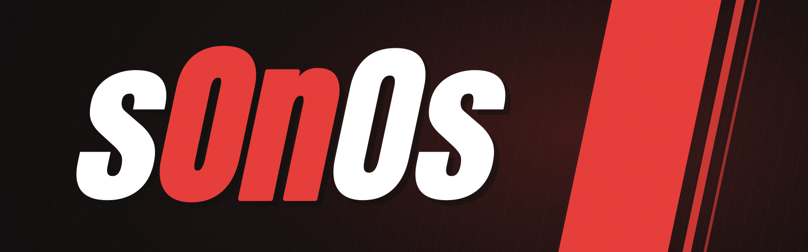

  

  <b>Plain Arch Linux. Nine questions to install.</b> 
  An operating system for developers and gamers.

  
  
  

---

sOnOs installs a desktop, gaming support with Steam and Vulkan, the NVIDIA driver and, if you want them, complete development toolchains. Underneath is a plain Arch Linux that stays compatible with the official repositories and the AUR.

## Projects

| | |
|---|---|
| **[sOnOs](https://github.com/aOnurTheDev/sOnOs)** | The live ISO: boots into the installer, and doubles as a rescue system with disk, network and recovery tools. |
| **[sOninstall](https://github.com/aOnurTheDev/sOnInstall)** | The installer. Asks nine questions, then sets up the whole system. A fork of [archinstall](https://github.com/archlinux/archinstall). |

## Nine questions

Language · keyboard layout · username · password · time zone · desktop environment · NVIDIA driver · development tools · disk

Everything else comes with sensible defaults: NetworkManager, PipeWire, Bluetooth, zram swap and systemd-boot. A summary is shown before anything is written to the disk.

## What you get

- **Gaming:** Steam, GameMode and Vulkan drivers for the GPU in the machine, including the 32-bit ones Steam needs
- **Graphics:** NVIDIA's open kernel driver `nvidia-open` for GTX 16, RTX 20 and newer, open-source drivers for everything else
- **Desktop:** KDE Plasma, GNOME, COSMIC, Hyprland and more, each with its everyday apps
- **Apps:** Firefox in your language, VLC, fastfetch, btop, zsh and Neovim
- **Development** *(optional, about 10 GB)*: GCC, Clang, Visual Studio Code, Docker, Arduino and AVR tools, and over 30 languages, from Rust, Go and Python to Haskell and Zig

An installation takes about **7 GB**, or about **17 GB** with the development tools.

## Get started

1. Download the latest ISO from [Releases](https://github.com/aOnurTheDev/sOnOs/releases). Large ISOs come split into parts (`sOnOs.iso.7z.001`, `.002`, ...); download all of them and extract the first one with 7-Zip.
2. Write it to a USB drive with Ventoy, balenaEtcher or `dd`.
3. Boot from the USB. The installer starts by itself.

## Contribute

sOnOs is in beta. Bug reports, feedback and pull requests are welcome, and so are new translations of the installer, which is already available in more than 40 languages.

  <a href="https://github.com/aOnurTheDev/sOnOs/issues">Report a bug</a> ·
  <a href="https://github.com/aOnurTheDev/sOnInstall">Installer source</a> ·
  <a href="https://github.com/aOnurTheDev/sOnOs">ISO profile</a>

sOnOs is an independent distribution, not affiliated with the Arch Linux project.
By aOnurTheDev.
